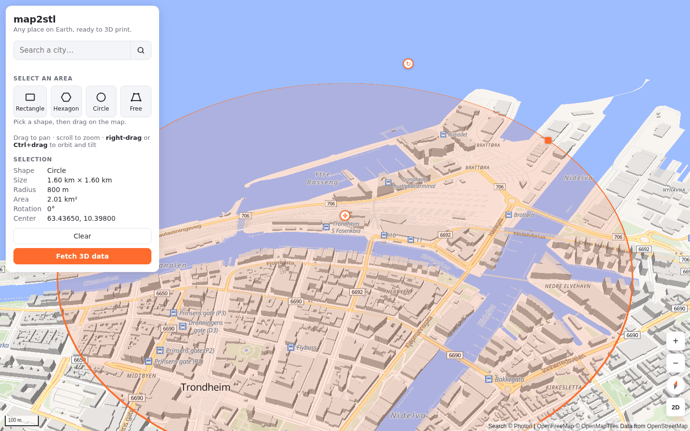
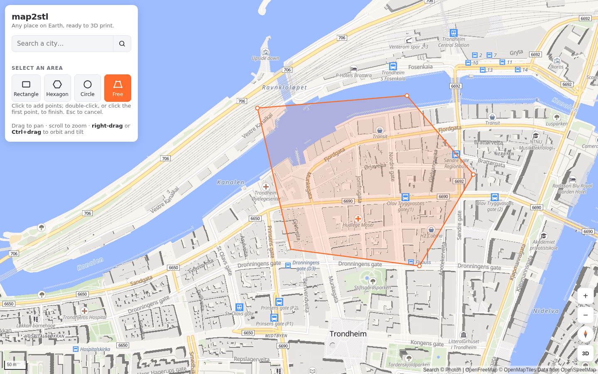
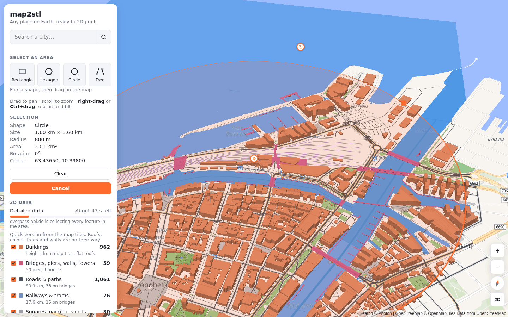
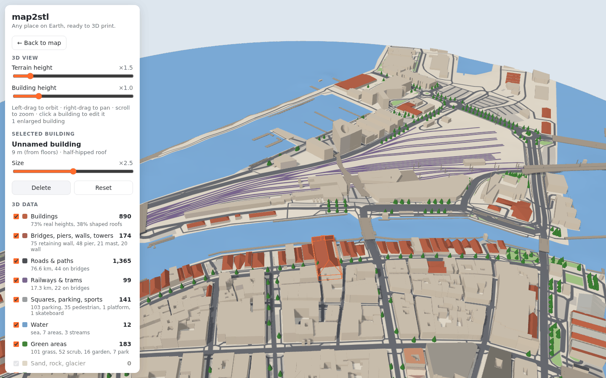

# map2stl

**Pick any place on Earth and turn it into a 3D-printable model.**

Search a city, draw the area you want, and map2stl downloads its buildings, terrain, water,
roads and greenery from open data, shows them in 3D, and lets you remove or enlarge buildings
before printing.


> **Status:** work in progress. Selecting an area, downloading the data, the 3D view and
> building editing work today. **Export to STL / 3MF is the next milestone** (see the
> [roadmap](ROADMAP.md)).

## Features

- **Any place, no account, no API keys.** Everything comes from open data: OpenStreetMap,
  OpenFreeMap tiles and AWS Terrain Tiles.
- **Four selection shapes**: rectangle, hexagon, circle, or a free shape you click point by
  point. Move, resize and rotate them with handles.
- **Quick version in seconds**, detailed version in under a minute: buildings with real
  heights, roof shapes and colors, bridges, piers, walls, towers, roads, rails, water
  (including the sea), parks and single trees.
- **3D preview** of the model as it will be printed: a terrain tile cut exactly to your
  shape, everything trimmed at the edge, with layer toggles and height exaggeration.
- **Edit buildings**: click one to delete it, or enlarge a landmark so it stands out in the
  print.

## Quick start

You need [Node.js](https://nodejs.org) 20.19+ (or 22.12+).

```sh
git clone https://github.com/albertomors/map2stl.git
cd map2stl
npm install
npm run dev
```

Then open **http://localhost:5173**.

To build a static site instead: `npm run build`. The output in `dist/` can be hosted on any
static web server.

## How to use it

### 1. Find the place and select an area

Search a city in the box at the top left, or pan and zoom the map. Pick a shape and drag on
the map: rectangles from corner to corner, hexagons and circles from the center outward.
Shapes follow the current view, so rotate the map first if you want the area tilted.

Afterwards, drag the handles: **center** moves the shape, **corner** resizes it, **top**
rotates it. Click outside the shape to clear it.



For any other outline, choose **Free**: click point by point, then double-click (or click
the first point) to close it.



### 2. Fetch the 3D data

Press **Fetch 3D data**. A quick version from the map tiles appears in a couple of seconds.
The detailed version (roof shapes, trees, walls, parking…) follows, usually in 30–90 s,
with an estimate of the time left, and replaces the quick version in place.



Each category gets a checkbox and a count. Uncheck what you don't want in the model.


### 3. Look at it in 3D

Press **Open 3D view**. Left-drag to orbit, right-drag to pan, scroll to zoom. The sliders
exaggerate the terrain and the buildings; the checkboxes hide layers.

### 4. Edit buildings

Click a building to select it. **Delete** removes it; **Size** enlarges it from its base
(×1–4), handy for making a cathedral or a tower stand out. **Reset** and **Restore all**
undo.



### 5. Export *(coming next)*

STL and 3MF export, with print size in millimeters and a base, is the next milestone.

The **[user guide](docs/guide.md)** covers every control, what the data contains and
the known limits.

## Data and credits

| What | Source | Terms |
|---|---|---|
| Map, building and road data | [OpenStreetMap](https://www.openstreetmap.org/copyright) contributors | ODbL: credit "© OpenStreetMap contributors" |
| Map tiles and quick data | [OpenFreeMap](https://openfreemap.org) | Free, no key |
| City search | [Photon](https://photon.komoot.io) by komoot | Fair use |
| Detailed OSM data | [Overpass API](https://overpass-api.de) public servers | Fair use |
| Terrain | [AWS Terrain Tiles](https://registry.opendata.aws/terrain-tiles/) | Open data |

Models made with map2stl contain OpenStreetMap data and must credit
**"© OpenStreetMap contributors"**.

Google's photorealistic 3D tiles are deliberately not used: their terms forbid exporting
the meshes, which is the whole point here.

## Project

- [User guide](docs/guide.md): every feature in detail.
- [Architecture](docs/architecture.md): how the code is organized, for contributors.
- [Roadmap](ROADMAP.md): what's next.
- [Changelog](CHANGELOG.md): what changed in each version.

Built with [MapLibre GL JS](https://maplibre.org), [Three.js](https://threejs.org),
[Vite](https://vite.dev) and TypeScript.
