# map2stl

**Turn any place on Earth into a 3D print.**

Want your fav city on the shelf? Or on the wall? Maybe a real-world map for your next board
game or tabletop campaign? Pick a place, select the area, customize it, and 3D-print it.

Buildings with their real heights and roofs, terrain from national LiDAR where there is
some, forests, rivers and the sea floor, all from open data, in your browser. Out come an
STL or a multi-color 3MF for your slicer, or a GLB for Blender.

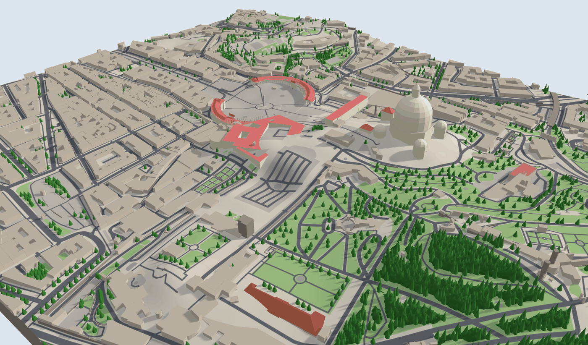

No account, no API key, nothing to install: open data straight from public servers.

[How it works](#how-it-works) · [Features](#features) · [Data sources](#data-sources) ·
[Credits](#credits-and-licenses) · [Run it](#run-it) · [User guide](docs/guide.md)

## How it works

<table>
<tr>
<td width="38%"><b>1. Find the place.</b><br>Type a town, a street, an address or a landmark. <b>Select</b> next to a result draws a rectangle around it.</td>
<td>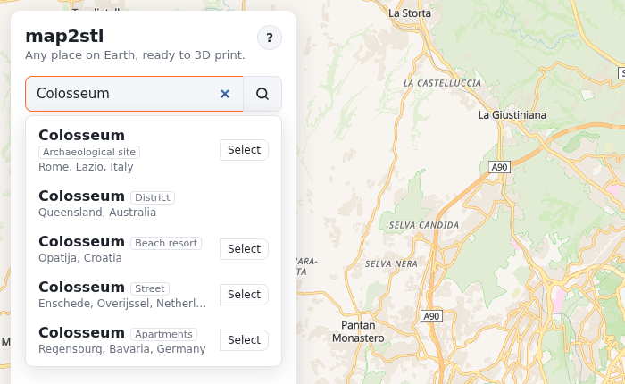</td>
</tr>
<tr>
<td><b>2. Select the area.</b><br>A rectangle, hexagon, circle or free shape. Move it, resize it, turn it.</td>
<td>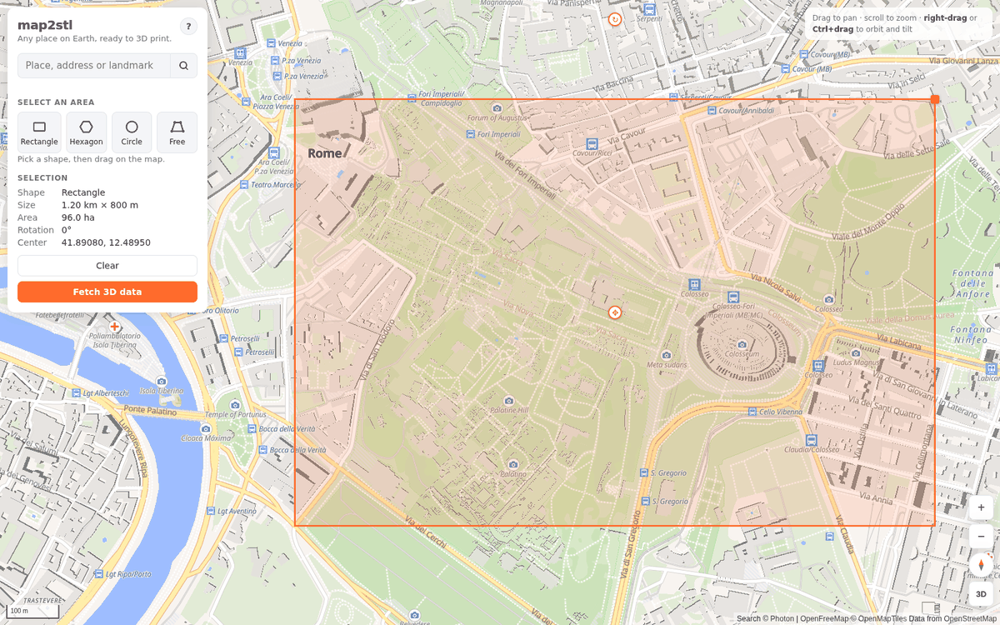</td>
</tr>
<tr>
<td><b>3. Fetch the 3D data.</b><br>A quick version from the map's tiles in a second or two, then the full OpenStreetMap data in 30–90 seconds, with the terrain.</td>
<td>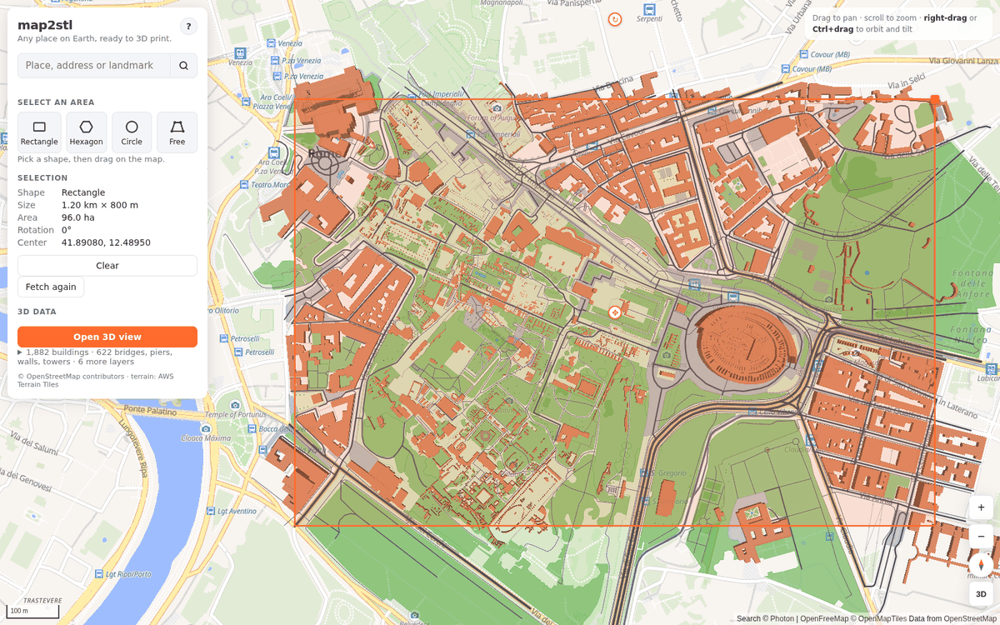</td>
</tr>
<tr>
<td><b>4. Shape it in 3D.</b><br>Delete what you don't want, make your favorite building stand out, put in a real 3D model of it.</td>
<td>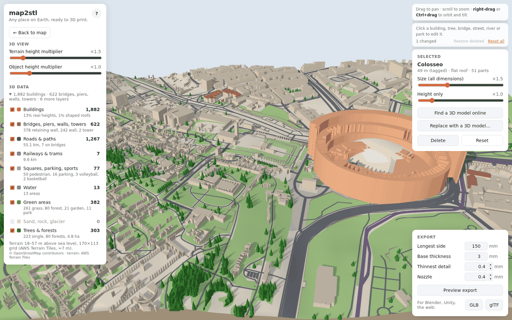</td>
</tr>
<tr>
<td><b>5. Export.</b><br>Preview the model exactly as it prints, then download STL or 3MF. Or GLB / glTF for other 3D software.</td>
<td>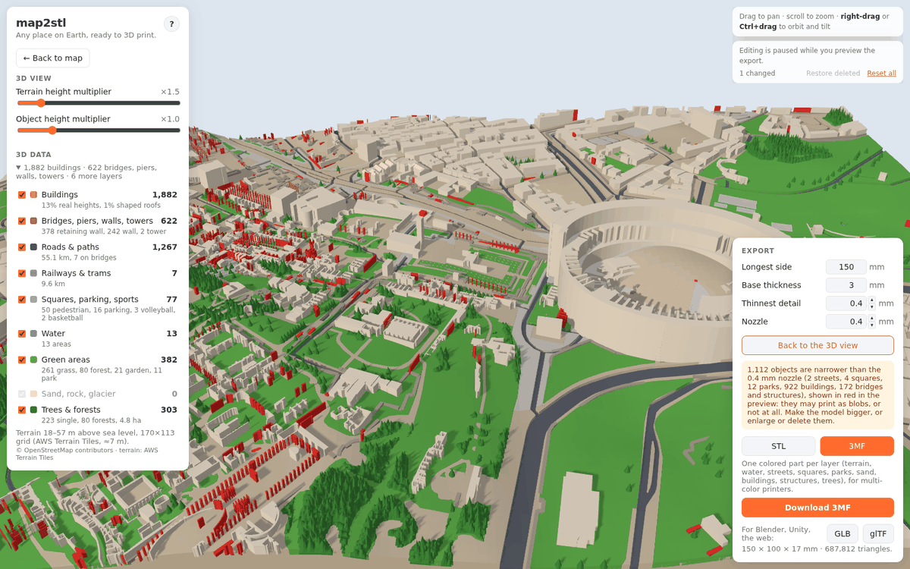</td>
</tr>
</table>

## Features

### Find and select

- **Search anything:** towns, streets, addresses ("Via Roma 12, Modena"), landmarks ("Eiffel
  Tower"). Famous places first, then those near where you're looking; a street comes as one
  result however many pieces it's mapped in.
- **Four shapes:** rectangle, hexagon, circle, or a free shape clicked point by point. Drawn
  along the view, so a tilted tile is just a rotated map away.
- **Links keep the view,** and the selection comes back after a reload.

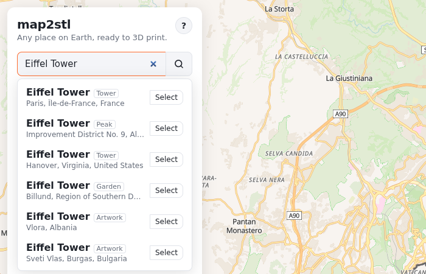

### Real places, in 3D

- **Buildings** with their height, roof shape and colors from OpenStreetMap; multi-part
  landmarks (a cathedral's nave, towers and spires) as one building.
- **Terrain** everywhere, and **national LiDAR** (about 1 m measured, fetched at 1–2.5 m) in
  Norway, the Netherlands, England and the US: ridges, gullies and rock faces come out sharp.
- **Forests** as one canopy of treetops, as tall as the LiDAR measured them where there's a
  surface model (Norway, the Netherlands, England), with clearings where nothing stands.
- **Water and the sea floor:** rivers, lakes, the sea rebuilt from coastlines, harbors
  and bays. Switch the Water layer off and the sea floor shows at its real depths.
- **Official 3D buildings** in Switzerland (swisstopo's swissBUILDINGS3D): measured roofs,
  dormers and towers, for one building or the whole area.
- Bridges sloping from bank to bank, piers, walls, towers, single trees, boats at the piers.

<table>
<tr>
<td width="50%">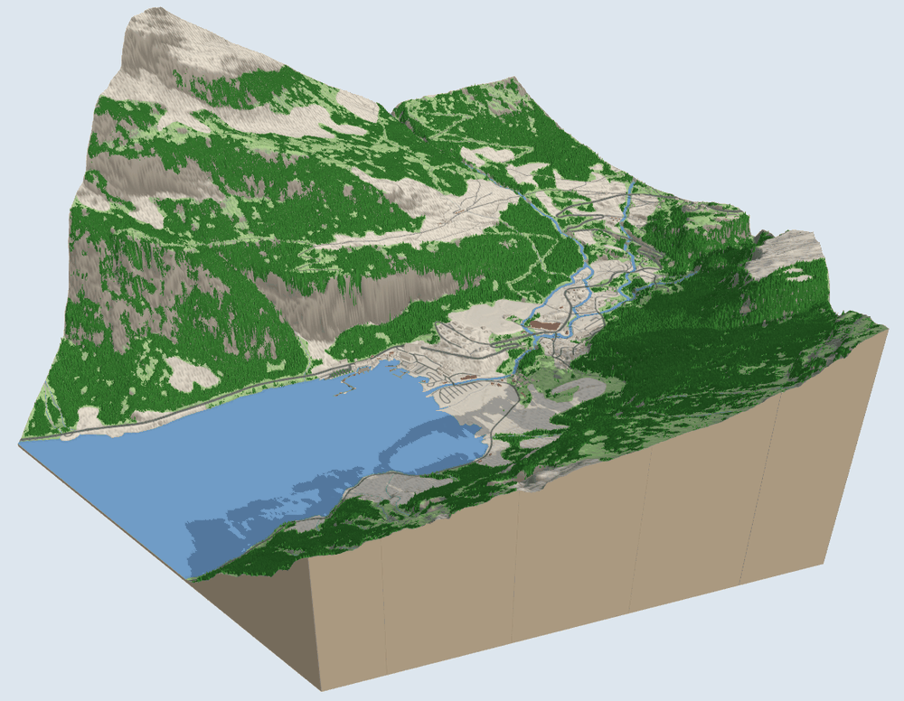</td>
<td width="50%"></td>
</tr>
<tr>
<td>Geirangerfjord, Norway: Kartverket's LiDAR at 2.2 m, in a hexagon.</td>
<td>Store Ådnøy, Norway: forests at their measured height, bare rock in between.</td>
</tr>
<tr>
<td>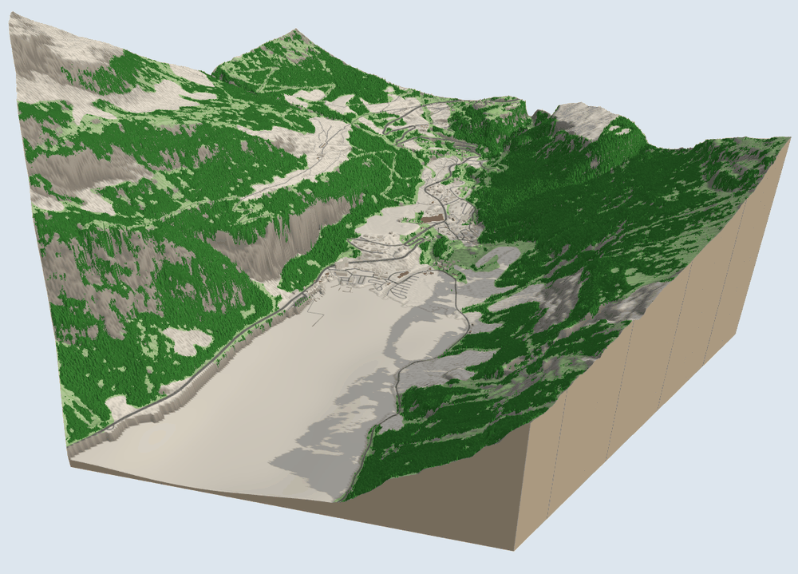</td>
<td></td>
</tr>
<tr>
<td>Water off: the fjord's floor at its real depth (EMODnet).</td>
<td>Zurich with swisstopo's official 3D buildings.</td>
</tr>
</table>

### Make it yours

- **Click anything to edit it:** a building, tree, bridge, tower, street, river or park.
  Delete it, resize it (×0.25–4), stretch its height, make a street wider, turn a square into a park.
  Restore deleted and Reset all undo it.
- **Landmarks as real 3D models:** find openly licensed models of a landmark on Wikimedia
  Commons and Sketchfab (with license, author and size shown), or use your own STL, OBJ,
  GLB or glTF. It's fitted to the footprint automatically, and the export credits its author.
- **Exaggerate** the terrain (×1–5) and everything standing on it (×0.5–3).

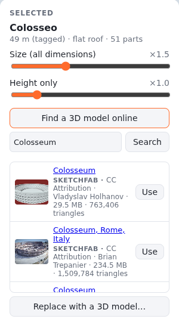

### Print it, or take it elsewhere

- **STL** (one watertight solid) or **3MF** with a colored part per layer: terrain, water,
  streets, squares, parks, sand, rock, buildings, bridges and structures, trees, forests,
  boats. The
  parts come pre-assigned to filaments in OrcaSlicer and Bambu Studio.
- **Print preview with a nozzle check:** the model exactly as it prints, at the size you
  chose. Anything narrower than the nozzle shows in red, forests too, with a count per part.
- Exact tile edges, a solid base, streets and water carved into the ground; every export
  merged into one watertight solid (manifold-3d).
- **GLB and glTF** for Blender, Unity, Unreal, Sketchfab or the web: the 3D view as it looks,
  painted ground with its relief shading, in meters with y up. No preview needed.

<table>
<tr>
<td width="50%"></td>
<td width="50%">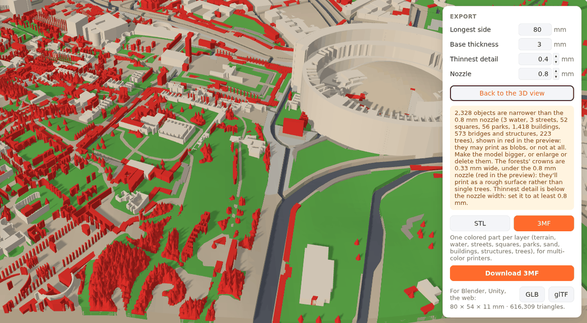</td>
</tr>
<tr>
<td>3MF preview: a color per part.</td>
<td>80 mm wide with a 0.8 mm nozzle: what won't print shows in red.</td>
</tr>
</table>

### Found a bug?

The **?** at the top of the panel opens a short form. Send saves a zip with your message, a
screenshot and what's needed to reproduce it (the selection, the view, your edits and
settings, the browser, recent errors; nothing else), and opens a message to attach it to.

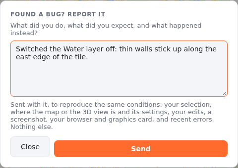

## Data sources

Everything comes from open data, fetched by your browser from public servers. The panel
says which source the terrain and the sea floor came from, and every export credits the
sources whose licenses ask for it.

### Map and objects

| Data | Source | Coverage | Notes | License |
|---|---|---|---|---|
| Buildings, roads, water, parks, trees, structures (detailed) | [OpenStreetMap](https://www.openstreetmap.org) via the [Overpass API](https://overpass-api.de) (overpass-api.de, then the maps.mail.ru mirror) | Worldwide | 30–90 s per area; cached in the browser for a week | [ODbL](https://www.openstreetmap.org/copyright) |
| Quick data and the base map | [OpenFreeMap](https://openfreemap.org) vector tiles (OpenMapTiles schema, zoom 14) | Worldwide | 1–3 s; no roofs, trees, walls or towers | OpenStreetMap data, ODbL |
| Search | [Photon](https://photon.komoot.io) by komoot | Worldwide | Towns, streets, addresses, landmarks | OpenStreetMap data, ODbL |

### Terrain

| Source | Coverage | Spacing | Forest heights | License |
|---|---|---|---|---|
| [AWS Terrain Tiles](https://registry.opendata.aws/terrain-tiles/) (Terrarium) | Worldwide, wherever nothing better covers | about 10–30 m underneath (zoom 14 grid) | no (15 m canopy) | see the [registry page](https://registry.opendata.aws/terrain-tiles/) |
| [Kartverket](https://www.kartverket.no), national height model (NHM) | Norway | about 1 m | yes (surface model) | CC BY 4.0 |
| [AHN](https://www.ahn.nl), Rijkswaterstaat via PDOK | The Netherlands | 0.5 m | yes (surface model) | CC0 |
| [Environment Agency](https://environment.data.gov.uk) LiDAR composite | England | 1 m | yes (first-return surface model) | Open Government Licence v3.0 |
| [USGS 3D Elevation Program](https://www.usgs.gov/3d-elevation-program) | The US | 1 m LiDAR over most of it, coarser elsewhere | no (15 m canopy) | Public domain |

LiDAR is asked for at the detail the print can use: 1 m for areas up to about 1 km across,
2–2.5 m for a 3 km tile. Where it has gaps (the sea, across a border), the worldwide tiles fill in.

### Sea floor

| Source | Coverage | Spacing | License |
|---|---|---|---|
| [EMODnet Bathymetry](https://emodnet.ec.europa.eu/en/bathymetry) | European seas | about 115 m | CC BY 4.0 |
| [NOAA ETOPO 2022](https://www.ncei.noaa.gov/products/etopo-global-relief-model), with NOAA's coastal DEMs where there are any | Everywhere else (and where EMODnet doesn't answer) | about 450 m, finer on the coastal models | Public domain |

### 3D buildings and models

| Source | Coverage | What | License |
|---|---|---|---|
| [swisstopo swissBUILDINGS3D](https://www.swisstopo.admin.ch/en/landscape-model-swissbuildings3d-3-0-beta) | Switzerland | Official measured 3D buildings, read from swisstopo's 3D Tiles | Free use (swisstopo open data) |
| [Wikimedia Commons](https://commons.wikimedia.org) and [Wikidata](https://www.wikidata.org) | Any landmark with a model | STL files: the landmark's Wikidata model, files depicting it, a name search | Per file (CC0, CC BY and the like), shown with each result |
| [Sketchfab](https://sketchfab.com) | Any landmark with a model | Downloadable models; downloads need your own (free) Sketchfab API token | Per model, mostly Creative Commons, shown with each result |

## Credits and licenses

Map data © [OpenStreetMap](https://www.openstreetmap.org/copyright) contributors, under the
ODbL. **Prints and files made with map2stl must credit them:** "© OpenStreetMap
contributors". The STL and 3MF carry the credit, and so do GLB and glTF files.

Besides OpenStreetMap, an export credits what it used: the national LiDAR terrain
(Kartverket, AHN, the Environment Agency, USGS), the sea depths when the sea floor shows
(EMODnet, NOAA), swisstopo's buildings, and any 3D model by its author and license. The
export card shows the full credit line after a download, ready to copy.

Tiles by [OpenFreeMap](https://openfreemap.org), search by [Photon](https://photon.komoot.io),
built with [MapLibre GL JS](https://maplibre.org), [Three.js](https://threejs.org) and
[manifold-3d](https://github.com/elalish/manifold).

## Run it

```sh
git clone https://github.com/albertomors/map2stl.git
cd map2stl
npm install
npm run dev     # http://localhost:5173
```

Needs [Node.js](https://nodejs.org) 20.19+ or 22.12+. `npm run build` type-checks and
builds a static site into `dist/`: it needs no server of its own.

## More

- [User guide](docs/guide.md): everything the app does, step by step
- [Architecture](docs/architecture.md): how it's put together
- [Roadmap](ROADMAP.md): what's next
- [Changelog](CHANGELOG.md): what shipped, version by version

## Support

Like it? Found it useful? [](https://ko-fi.com/W7A529A7ZI)
