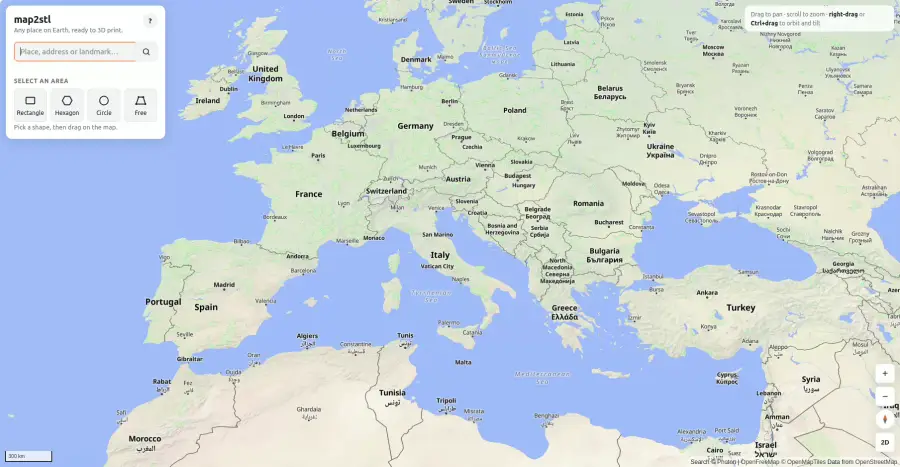
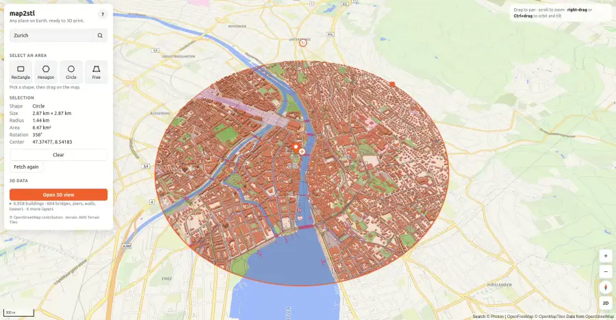
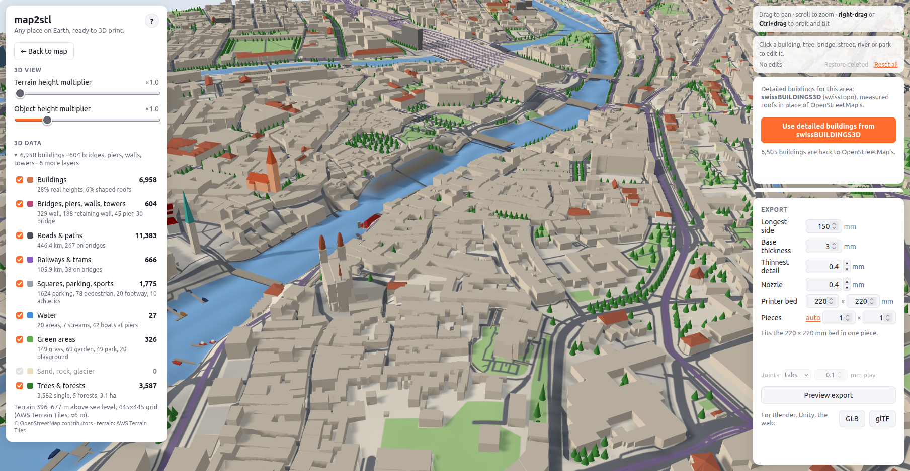
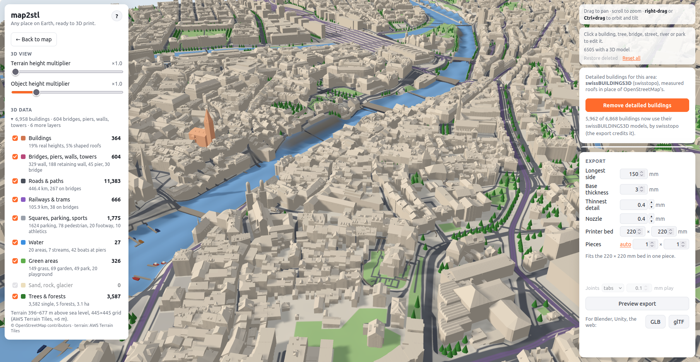

# map2stl: 3D-printable maps of any place on Earth

Want your favorite city on the shelf, or on the wall? A real-world map for your next board
game or tabletop campaign? Find a place, select the area, shape it in 3D, and print it.

Buildings with their real heights and roofs, terrain, forests, rivers and the sea floor,
all from open data, in your browser. Export STL or multi-color 3MF for your slicer, or GLB
and glTF for other 3D software. No account, no API key, nothing to install.

[Quick start](#quick-start) · [How it works](#how-it-works) · [Features](#features) ·
[Data sources](#data-sources) · [User guide](docs/guide.md)

## Quick start

```sh
git clone https://github.com/albertomors/map2stl.git
cd map2stl
npm install
npm run dev     # http://localhost:5173
```

Needs [Node.js](https://nodejs.org) 20.19+ or 22.12+. `npm run build` type-checks and
builds a static site into `dist/`: it needs no server of its own.

## How it works

### 1. Find a place and select the area

Search a town, a street, an address or a landmark, then draw a rectangle, hexagon, circle
or a free shape over it. **Fetch 3D data** brings a quick version from the map's own tiles
in a second or two, then the full OpenStreetMap data, with the terrain, in 30–90 seconds.



### 2. Shape it in 3D

Orbit around the model, exaggerate the terrain and the buildings, and click anything to
edit it: delete a building, enlarge your favorite one, widen a street, turn a square into a
park, or put in a real 3D model of a landmark.



### 3. Measured buildings, where a city publishes them

Where there are official 3D city models, one click swaps OpenStreetMap's blocks for the
measured buildings: real roofs, dormers, towers and spires. Switzerland, the Netherlands,
Japan's cities, Hamburg, Helsinki and Hong Kong so far.

<table>
<tr>
<td width="50%"></td>
<td width="50%"></td>
</tr>
<tr>
<td>Zurich with OpenStreetMap's buildings.</td>
<td>The same view with swissBUILDINGS3D.</td>
</tr>
</table>

### 4. Export, in pieces if it's bigger than your printer

Preview the model exactly as it prints: anything thinner than your nozzle shows in red.
Bigger than your bed? It's split into the fewest pieces that fit, with joints in the base
that line them up.

<!-- docs/screenshots/export.webp: the export settings and printing in pieces (to come) -->

## Features

### Find and select

- **Search anything:** towns, streets, addresses ("Via Roma 12, Modena"), landmarks
  ("Eiffel Tower"). The best-known place first, then those near where you're looking.
- **Four shapes:** rectangle, hexagon, circle, or a free shape clicked point by point,
  drawn along the view. Move, resize and turn the selection in place.
- **Links keep the view,** and the selection comes back after a reload.

### Real places, in 3D

- **Buildings** with their height, roof shape and colors from OpenStreetMap; multi-part
  landmarks (a cathedral's nave, towers and spires) as one building.
- **Official 3D buildings** in Switzerland (swissBUILDINGS3D), the Netherlands (3DBAG),
  Japan's cities (PLATEAU), Hamburg, Helsinki and Hong Kong: for one building or a whole
  city at once.
- **Terrain** everywhere, with the bumps big buildings leave in it taken out.
- **Forests** as one canopy of treetops, with single trees along their edges.
- **Water and the sea floor:** rivers, lakes, harbors and the sea. Switch the Water layer
  off and the sea floor shows at its real depths.
- Bridges sloping from bank to bank, piers, walls, towers, single trees, boats at the piers.

### Make it yours

- **Click anything to edit it:** a building, tree, bridge, tower, street, river or park.
  Delete it, resize it, stretch its height, widen a street, turn a square into a park.
- **Landmarks as real 3D models:** openly licensed models from Wikimedia Commons and
  Sketchfab, or your own STL, OBJ, GLB or glTF, fitted to the footprint automatically.
- **Exaggerate** the terrain (×1–5) and everything standing on it (×0.5–3).

### Print it, or take it elsewhere

- **STL** for any slicer, as one watertight solid, or **3MF** with a colored part per layer
  (terrain, water, streets, parks, buildings, trees…), ready for multi-color printing in
  OrcaSlicer and Bambu Studio.
- **A print preview with a nozzle check:** the model exactly as it prints; anything
  narrower than the nozzle shows in red.
- **Print in pieces:** the fewest that fit your bed, or your own grid, each one closed on
  every side. Tabs and pockets line them up, or bowtie keys hold them without glue. A zip
  of STLs, or one 3MF with an object per piece.
- **GLB and glTF** for Blender, Unity, Unreal, Sketchfab or the web: the 3D view as it
  looks, with your edits.

## Data sources

Everything comes from open data, fetched by your browser from public servers. The panel
says where the terrain and the sea floor came from, and every export credits the sources
whose licenses ask for it.

### Map and objects

| Data | Source | Coverage | Notes | License |
|---|---|---|---|---|
| Buildings, roads, water, parks, trees, structures (detailed) | [OpenStreetMap](https://www.openstreetmap.org) via the [Overpass API](https://overpass-api.de) (overpass-api.de, then the maps.mail.ru mirror) | Worldwide | 30–90 s per area; cached in the browser for a week | [ODbL](https://www.openstreetmap.org/copyright) |
| Quick data and the base map | [OpenFreeMap](https://openfreemap.org) vector tiles (OpenMapTiles schema, zoom 14) | Worldwide | 1–3 s; no roofs, trees, walls or towers | OpenStreetMap data, ODbL |
| Search | [Photon](https://photon.komoot.io) by komoot | Worldwide | Towns, streets, addresses, landmarks | OpenStreetMap data, ODbL |

### Terrain and sea floor

| Source | Coverage | Spacing | License |
|---|---|---|---|
| [AWS Terrain Tiles](https://registry.opendata.aws/terrain-tiles/) (Terrarium) | Worldwide | about 10–30 m underneath (zoom 14 grid) | see the [registry page](https://registry.opendata.aws/terrain-tiles/) |
| [EMODnet Bathymetry](https://emodnet.ec.europa.eu/en/bathymetry) | European seas | about 115 m | CC BY 4.0 |
| [NOAA ETOPO 2022](https://www.ncei.noaa.gov/products/etopo-global-relief-model), with NOAA's coastal DEMs where there are any | Every other sea (and where EMODnet doesn't answer) | about 450 m, finer on the coastal models | Public domain |

### 3D buildings and models

| Source | Coverage | What | License |
|---|---|---|---|
| [swisstopo swissBUILDINGS3D](https://www.swisstopo.admin.ch/en/landscape-model-swissbuildings3d-3-0-beta) | Switzerland | Official measured 3D buildings, read from swisstopo's 3D Tiles | Free use (swisstopo open data) |
| [3DBAG](https://3dbag.nl) by tudelft3d and 3DGI | The Netherlands | Every building at LoD2.2, read from 3DBAG's 3D Tiles | CC BY 4.0 |
| [Project PLATEAU](https://www.mlit.go.jp/plateau/) (MLIT Japan) | 265 Japanese cities | Official 3D city models (LoD2), read from PLATEAU's 3D Tiles | Public Data License 1.0 (compatible with CC BY 4.0) |
| [Hamburg LoD2](https://www.hamburg.de/bsw/landesbetrieb-geoinformation-und-vermessung/) (LGV) | Hamburg | The city's LoD2 buildings, read from its 3D Tiles | dl-de/by-2-0 |
| [Helsinki 3D city model](https://kartta.hel.fi/3d/) | Helsinki | The city's LoD2 buildings, read from its 3D Tiles | CC BY 4.0 |
| [Hong Kong 3D Spatial Data](https://portal.csdi.gov.hk/csdi-webpage/apidoc/3d-spatial-data-api) (Lands Department, CSDI Portal) | Hong Kong | Every building, read from the Lands Department's 3D Tiles | CSDI Portal terms (free use, with credit) |
| [Wikimedia Commons](https://commons.wikimedia.org) and [Wikidata](https://www.wikidata.org) | Any landmark with a model | STL files: the landmark's Wikidata model, files depicting it, a name search | Per file (CC0, CC BY and the like), shown with each result |
| [Sketchfab](https://sketchfab.com) | Any landmark with a model | Downloadable models; downloads need your own (free) Sketchfab API token | Per model, mostly Creative Commons, shown with each result |

## License

map2stl's code is under the [MIT License](LICENSE). The data keeps its own licenses (see
[Data sources](#data-sources)); prints and files made from OpenStreetMap data must credit
"© OpenStreetMap contributors" (every export carries the credit).

## More

- [User guide](docs/guide.md): everything the app does, step by step
- [Architecture](docs/architecture.md): how it's put together
- [Roadmap](ROADMAP.md): what's next
- [Changelog](CHANGELOG.md): what shipped, version by version

## Support

Like it? Found it useful? [](https://ko-fi.com/W7A529A7ZI)
