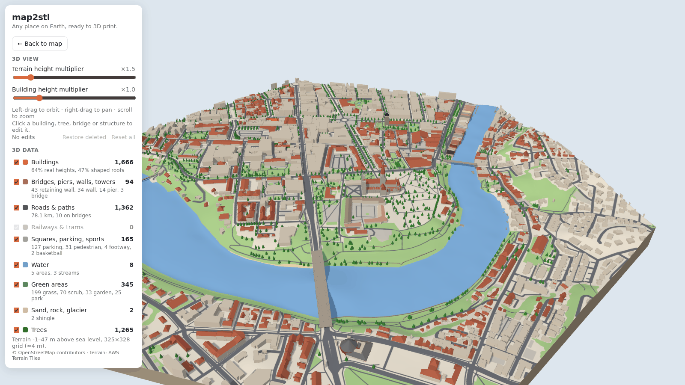
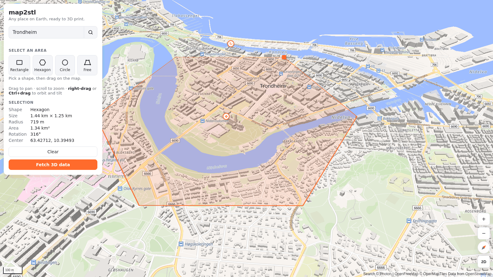
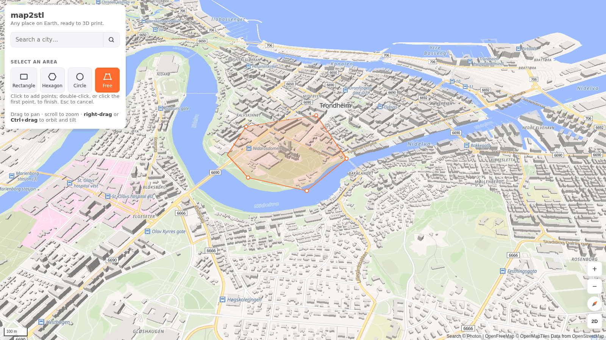
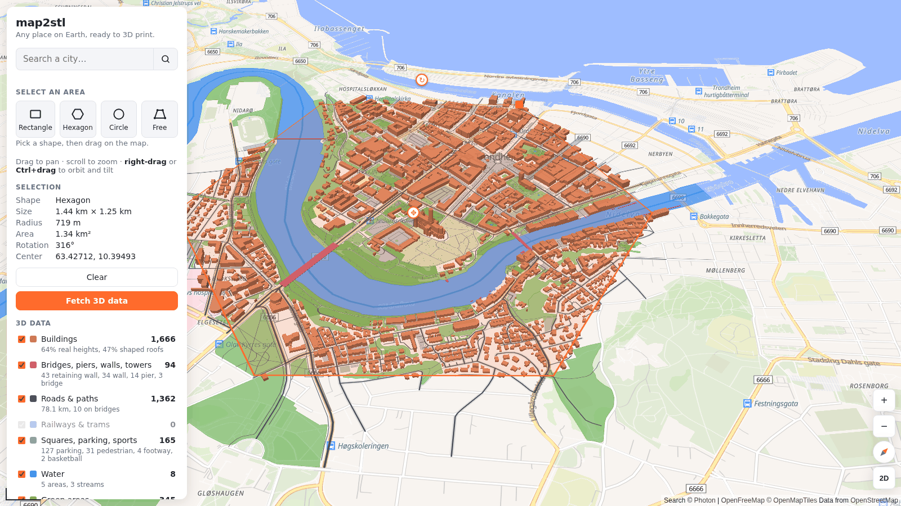
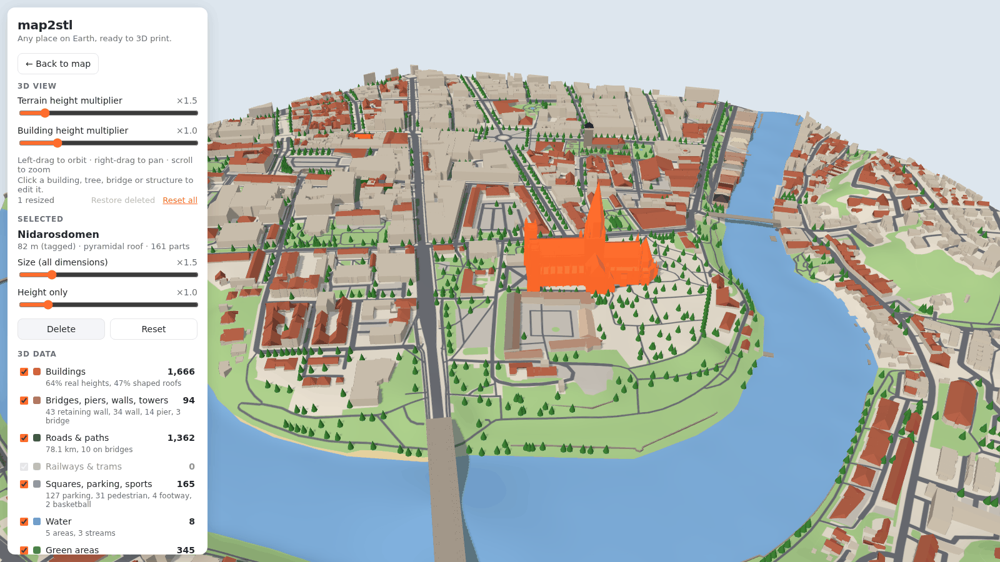

# map2stl

**Pick any place on Earth and turn it into a 3D-printable model.**

Search a city, draw the area you want, and map2stl downloads its buildings, terrain, water,
roads and greenery from open data, shows them in 3D, and lets you remove, enlarge or
stretch any object before printing.



> **Status:** work in progress. Selecting an area, downloading the data, the 3D view and
> object editing work today. **Export to STL / 3MF is the next milestone** (see the
> [roadmap](ROADMAP.md)).

## Features

- **Any place, no account, no API keys.** Everything comes from open data: OpenStreetMap,
  OpenFreeMap tiles and AWS Terrain Tiles.
- **Four selection shapes**: rectangle, hexagon, circle, or a free shape you click point by
  point. Move, resize and rotate them with handles.
- **Quick version in seconds**, detailed version in under a minute: buildings with real
  heights, roof shapes and colors, multi-part landmarks, bridges, piers, walls, towers,
  roads, water (including the sea), parks and single trees.
- **3D preview** of the model as it will be printed: a terrain tile cut exactly to your
  shape, everything trimmed at the edge, with layer toggles and height multipliers.
- **Edit objects**: click a building, tree, bridge or structure to delete it, enlarge it,
  or stretch its height, so a cathedral or a tower stands out in the print.

## Quick start

You need [Node.js](https://nodejs.org) 20.19+ (or 22.12+).

```sh
git clone https://github.com/albertomors/map2stl.git
cd map2stl
npm install
npm run dev
```

Then open **http://localhost:5173**.

To build a static site instead: `npm run build`. The output in `dist/` can be hosted on any
static web server.

## How to use it

The walkthrough below models the heart of Trondheim, Norway: Nidarosdomen cathedral and the
old town inside the loop of the Nidelva river.

### 1. Find the place and select an area

Search **Trondheim** in the box at the top left. Pick **Hexagon** and drag from the center
outward. Shapes follow the current view, so rotate the map first (right-drag) if you want
the area tilted: this hexagon was drawn on a map turned 44°, and it covers 1.34 km².

Afterwards, drag the handles: **center** moves the shape, **corner** resizes it, **top**
rotates it. Click outside the shape to clear it.



For any other outline, choose **Free**: click point by point, then double-click (or click
the first point) to close it. Here, just the cathedral grounds:



### 2. Fetch the 3D data

Press **Fetch 3D data**. A quick version from the map tiles appears in a couple of seconds,
so you can already look around. The detailed version (roof shapes, the cathedral's 161
parts, trees, walls, parking…) follows, usually in 30–90 s, with an estimate of the time
left, and replaces the quick one in place.


Each category gets a checkbox and a count: here 1,666 buildings, 1,362 roads and paths,
1,265 trees. Uncheck what you don't want in the model.



### 3. Look at it in 3D

Press **Open 3D view**. Left-drag to orbit, right-drag to pan, scroll to zoom. The two
**height multipliers** exaggerate the terrain and the buildings; the checkboxes hide
layers.

### 4. Edit objects

Click an object to select it. **Delete** removes it; **Size** enlarges it from its base
(×1–4); **Height only** stretches it vertically. Here Nidarosdomen (82 m spire, 161 parts,
selected as one building) is enlarged ×1.5 so it stands out in the print. **Reset**,
**Restore deleted** and **Reset all** undo.



### 5. Export *(coming next)*

STL and 3MF export, with print size in millimeters and a base, is the next milestone.

The **[user guide](docs/guide.md)** covers every control, what the data contains and
the known limits.

## Data and credits

| What | Source | Terms |
|---|---|---|
| Map, building and road data | [OpenStreetMap](https://www.openstreetmap.org/copyright) contributors | ODbL: credit "© OpenStreetMap contributors" |
| Map tiles and quick data | [OpenFreeMap](https://openfreemap.org) | Free, no key |
| City search | [Photon](https://photon.komoot.io) by komoot | Fair use |
| Detailed OSM data | [Overpass API](https://overpass-api.de) public servers | Fair use |
| Terrain | [AWS Terrain Tiles](https://registry.opendata.aws/terrain-tiles/) | Open data |

Models made with map2stl contain OpenStreetMap data and must credit
**"© OpenStreetMap contributors"**.

Google's photorealistic 3D tiles are deliberately not used: their terms forbid exporting
the meshes, which is the whole point here.

## Project

- [User guide](docs/guide.md): every feature in detail.
- [Architecture](docs/architecture.md): how the code is organized, for contributors.
- [Roadmap](ROADMAP.md): what's next.
- [Changelog](CHANGELOG.md): what changed in each version.

Built with [MapLibre GL JS](https://maplibre.org), [Three.js](https://threejs.org),
[Vite](https://vite.dev) and TypeScript.
