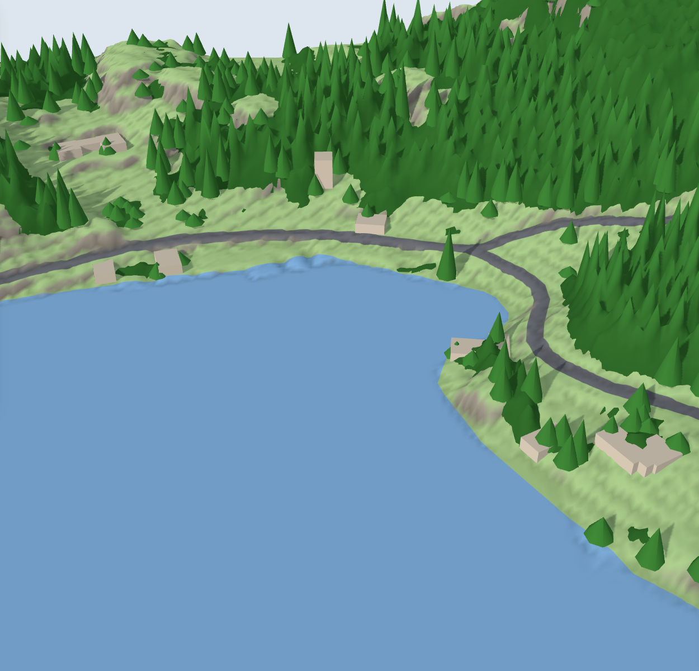

# map2stl

**Turn any place on Earth into a 3D print.**

Want your fav city on the shelf? Or on the wall? Maybe a real-world map for your next board game or tabletop campaign? Pick a city, select the area, customize it, and 3d-print it.


## How it works

1. **Pick a place and select the area** you want to print.
2. **Shape it in 3D**: remove what you don't want, make your favorite building stand out.
3. **Export and print**: STL, or multi-color 3MF with each layer its own part.


## Real terrain, real forests

Where a country publishes its laser-scanned (LiDAR) height model, map2stl uses it: about
1 m detail instead of the 10–30 m of worldwide elevation data, so ridges, gullies, cliffs
and rock faces come out sharp. Norway, the Netherlands, England and the US so far.

Forests aren't scattered cones: a wood is one canopy of pointed treetops, as tall as the
LiDAR measures its trees, opening into clearings where it finds none, with single trees
standing along its edges. The same canopy prints as a rough, raised layer. With the water
off, the sea floor shows at its real depths.



## Official 3D buildings

Where a country publishes its buildings as measured 3D models, one click swaps OpenStreetMap's
blocks for the real thing: roof shapes, dormers, towers. Switzerland's swissBUILDINGS3D
first, for one building or the whole area at once.


## Features

- **No API keys, no account.** Open data only: OpenStreetMap, OpenFreeMap, AWS Terrain
  Tiles, national LiDAR and 3D building models, sea depths.
- **Real 3D data.** Building heights, roof shapes and colors, landmarks, bridges, terrain,
  water and the sea floor, parks, forests, single trees, boats at the piers.
- **Real 3D models.** Replace a landmark with an openly licensed model from Wikimedia
  Commons or Sketchfab, or your own STL, OBJ or glTF, fitted to its footprint
  automatically.
- **Editable 3D preview.** Delete, resize or stretch any building, tree or bridge; change
  what a street or a park prints as. Make the cathedral twice as big if you like.
- **Ready to print.** Exact tile edges, a solid base, details never thinner than your
  nozzle can print, a preview of the export before downloading, STL and multi-color 3MF.


## Run it

```sh
git clone https://github.com/albertomors/map2stl.git
cd map2stl
npm install
npm run dev     # http://localhost:5173
```

Needs [Node.js](https://nodejs.org) 20.19+.

## Credits

Map data © [OpenStreetMap](https://www.openstreetmap.org/copyright) contributors (ODbL):
prints made with map2stl must credit them. Tiles by [OpenFreeMap](https://openfreemap.org),
search by [Photon](https://photon.komoot.io), detailed data from the
[Overpass API](https://overpass-api.de), terrain from
[AWS Terrain Tiles](https://registry.opendata.aws/terrain-tiles/). LiDAR terrain from
[Kartverket](https://www.kartverket.no) (CC BY 4.0), [AHN](https://www.ahn.nl) (CC0), the
[Environment Agency](https://environment.data.gov.uk) (OGL) and
[USGS 3DEP](https://www.usgs.gov/3d-elevation-program); sea depths from
[EMODnet Bathymetry](https://emodnet.ec.europa.eu/en/bathymetry) (CC BY 4.0) and
[NOAA ETOPO 2022](https://www.ncei.noaa.gov/products/etopo-global-relief-model); 3D
buildings from [swisstopo](https://www.swisstopo.admin.ch) (swissBUILDINGS3D). Exports credit
the sources they use. Built with [MapLibre](https://maplibre.org) and
[Three.js](https://threejs.org).

More: [user guide](docs/guide.md) · [architecture](docs/architecture.md) ·
[roadmap](ROADMAP.md) · [changelog](CHANGELOG.md)

## Support

Like it? Found it useful? [](https://ko-fi.com/W7A529A7ZI)
