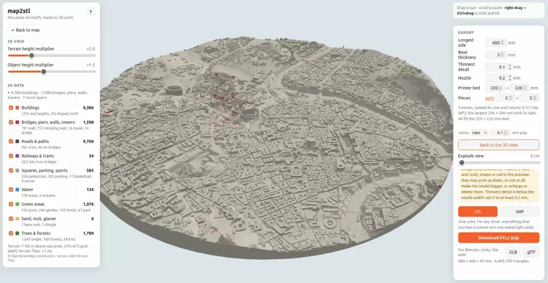

# map2stl: 3D-printable maps of any place on Earth

Your favorite city on the shelf. A real place for your next tabletop campaign. Find it,
select it, shape it in 3D, print it.

Real buildings, terrain, rivers and the sea floor, from open data, in your browser. No
account, no API key, nothing to install.

[Quick start](#quick-start) · [How it works](#how-it-works) · [Features](#features) ·
[Data sources](#data-sources) · [User guide](docs/guide.md)

## Quick start

```sh
git clone https://github.com/albertomors/map2stl.git
cd map2stl
npm install
npm run dev     # http://localhost:5173
```

Needs [Node.js](https://nodejs.org) 20.19+ or 22.12+. `npm run build` type-checks and
builds a static site into `dist/`: it needs no server of its own.

## How it works

### 1. Find any place

Search any town, street, address or landmark, draw a rectangle, hexagon, circle or any
shape, and fetch it: a first look in seconds, the full detail in about a minute.


### 2. Make it yours

Fly around it. Click anything to change it: delete a building, enlarge your favorite one,
turn a square into a park, or swap a landmark for a real 3D model.


### 3. The real buildings, where cities publish them

Where a city publishes its official 3D model, one click swaps OpenStreetMap's blocks for
the real thing: every roof, dormer and spire.


<sub>Zurich with OpenStreetMap's buildings.</sub>


<sub>The same view with swissBUILDINGS3D.</sub>

### 4. Print it, even bigger than your printer

See it exactly as it will print, with anything too thin for your nozzle in red. Too big
for your printer? It splits into pieces that fit your bed and snap back together.



## Features

- **Real buildings:** heights, roof shapes and colors from OpenStreetMap.
- **Official 3D buildings where available:** Switzerland (swissBUILDINGS3D), the
  Netherlands (3DBAG), Japan (PLATEAU), Hamburg, Helsinki and Hong Kong.
- **Water and the sea floor:** rivers, lakes, harbors, and the sea at its real depths.
- **Edit anything:** delete, resize or retype a building, street, river or park, or swap a
  landmark for a 3D model from Wikimedia Commons, Sketchfab or your own file.
- **Every format:** STL for any slicer, multi-color 3MF for OrcaSlicer and Bambu Studio,
  GLB and glTF for Blender, Unity and the web.
- **No surprises:** the preview shows the print exactly as it comes out, nozzle check
  included.
- **Too big to print? Split it into pieces.** Sized to your bed, joined by tabs or locked
  with bowtie keys.

## Data sources

All open data, fetched by your browser; every export credits the sources that ask for it.

| Data | Source | License |
|---|---|---|
| Map, buildings, roads, water, parks | [OpenStreetMap](https://www.openstreetmap.org) via [Overpass](https://overpass-api.de); base map by [OpenFreeMap](https://openfreemap.org), search by [Photon](https://photon.komoot.io) | [ODbL](https://www.openstreetmap.org/copyright) |
| Terrain | [AWS Terrain Tiles](https://registry.opendata.aws/terrain-tiles/) | see the registry |
| Sea floor | [EMODnet](https://emodnet.ec.europa.eu/en/bathymetry) in Europe, [NOAA ETOPO 2022](https://www.ncei.noaa.gov/products/etopo-global-relief-model) elsewhere | CC BY 4.0, public domain |
| Official 3D buildings | [swissBUILDINGS3D](https://www.swisstopo.admin.ch/en/landscape-model-swissbuildings3d-3-0-beta), [3DBAG](https://3dbag.nl), [PLATEAU](https://www.mlit.go.jp/plateau/), [Hamburg](https://www.hamburg.de/bsw/landesbetrieb-geoinformation-und-vermessung/), [Helsinki](https://kartta.hel.fi/3d/), [Hong Kong](https://portal.csdi.gov.hk/csdi-webpage/apidoc/3d-spatial-data-api) | open data, each its own license (CC BY 4.0 and similar) |
| Landmark models | [Wikimedia Commons](https://commons.wikimedia.org), [Sketchfab](https://sketchfab.com) (free API token) | per model, shown with each |

## License

map2stl's code is under the [MIT License](LICENSE). The data keeps its own licenses (see
[Data sources](#data-sources)); prints and files made from OpenStreetMap data must credit
"© OpenStreetMap contributors" (every export carries the credit).

## More

- [User guide](docs/guide.md): everything the app does, step by step
- [Architecture](docs/architecture.md): how it's put together
- [Roadmap](ROADMAP.md): what's next
- [Changelog](CHANGELOG.md): what shipped, version by version

## Support

Like it? Found it useful? [](https://ko-fi.com/W7A529A7ZI)
