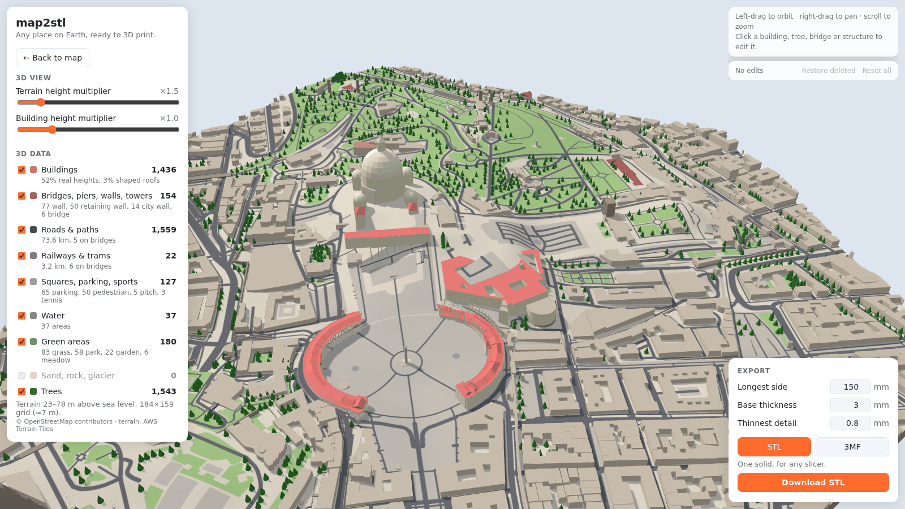
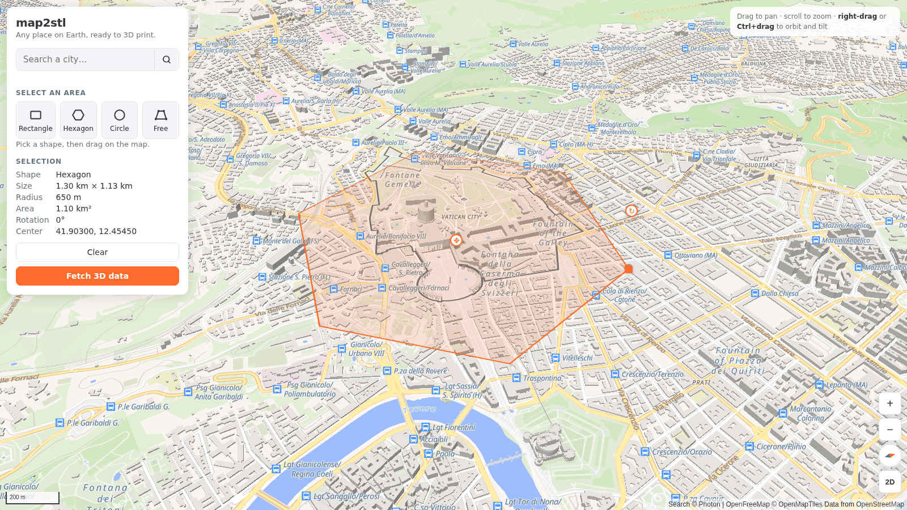
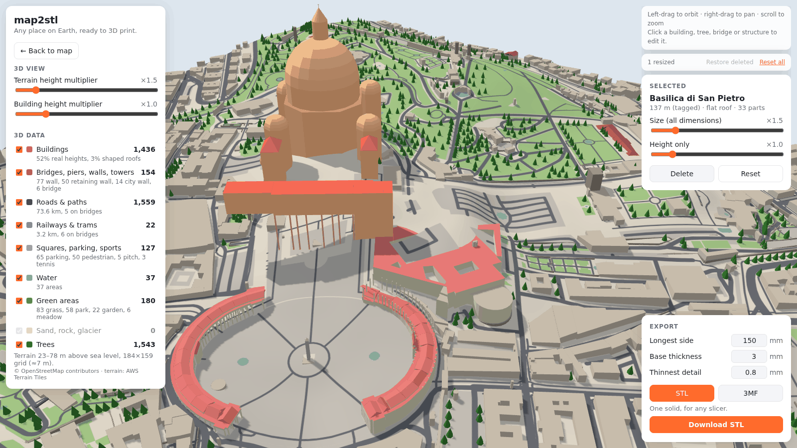
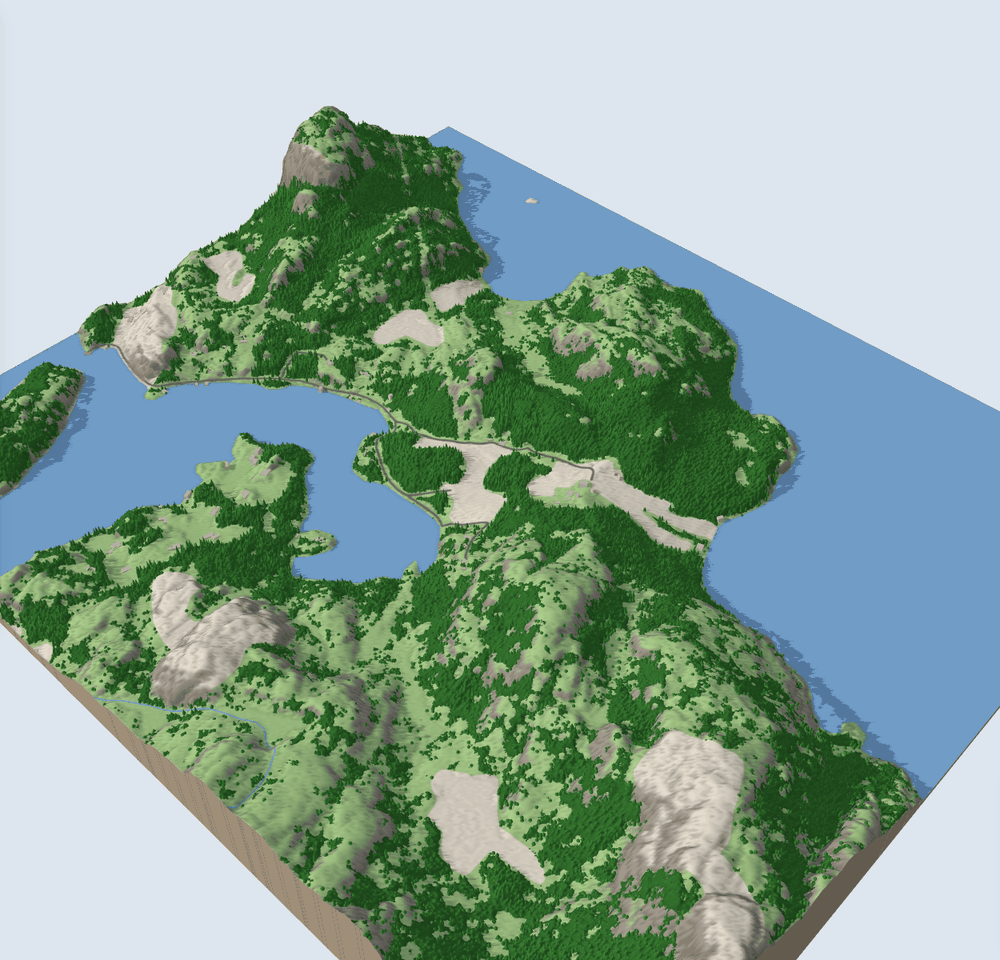
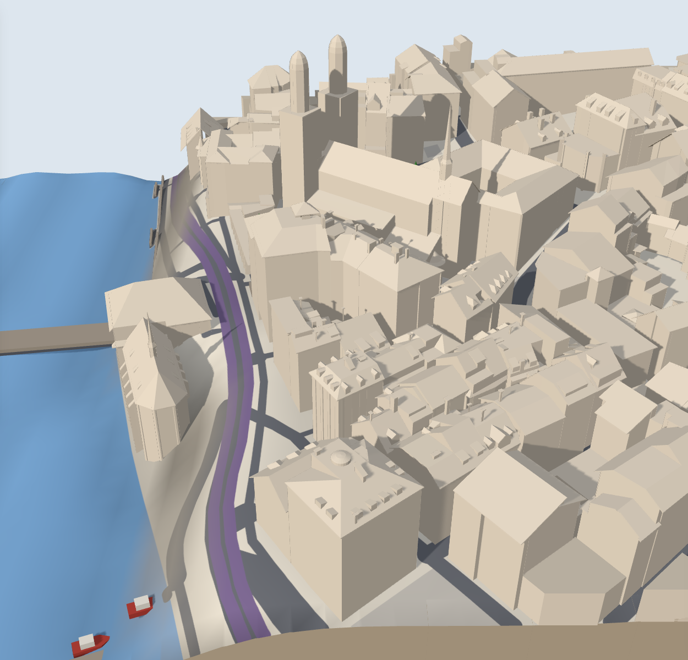

# map2stl

**Turn any place on Earth into a 3D print.**

Want your fav city on the shelf? Or on the wall? Maybe a real-world map for your next board game or tabletop campaign? Pick a city, select the area, customize it, and 3d-print it.



## How it works

1. **Pick a city and select the area** you want to print.
2. **Shape it in 3D**: remove what you don't want, make your favorite building stand out.
3. **Export and print** *(STL / 3MF, coming next)*.



## Features

- **No API keys, no account.** Open data only: OpenStreetMap, OpenFreeMap, AWS Terrain
  Tiles.
- **Real 3D data.** Building heights, roof shapes and colors, landmarks, bridges, terrain,
  water, parks, single trees.
- **Editable 3D preview.** Delete, resize or stretch any building, tree or bridge. Make the
  cathedral twice as big if you like.
- **Ready to print** *(coming next)*. Exact tile edges, a solid base, STL and multi-color
  3MF.







## Run it

```sh
git clone https://github.com/albertomors/map2stl.git
cd map2stl
npm install
npm run dev     # http://localhost:5173
```

Needs [Node.js](https://nodejs.org) 20.19+.

## Credits

Map data © [OpenStreetMap](https://www.openstreetmap.org/copyright) contributors (ODbL):
prints made with map2stl must credit them. Tiles by [OpenFreeMap](https://openfreemap.org),
search by [Photon](https://photon.komoot.io), detailed data from the
[Overpass API](https://overpass-api.de), terrain from
[AWS Terrain Tiles](https://registry.opendata.aws/terrain-tiles/). LiDAR terrain from
[Kartverket](https://www.kartverket.no) (CC BY 4.0), [AHN](https://www.ahn.nl) (CC0), the
[Environment Agency](https://environment.data.gov.uk) (OGL) and
[USGS 3DEP](https://www.usgs.gov/3d-elevation-program); sea depths from
[EMODnet Bathymetry](https://emodnet.ec.europa.eu/en/bathymetry) (CC BY 4.0) and
[NOAA ETOPO 2022](https://www.ncei.noaa.gov/products/etopo-global-relief-model); 3D
buildings from [swisstopo](https://www.swisstopo.admin.ch) (swissBUILDINGS3D). Exports credit
the sources they use. Built with [MapLibre](https://maplibre.org) and
[Three.js](https://threejs.org).

More: [user guide](docs/guide.md) · [architecture](docs/architecture.md) ·
[roadmap](ROADMAP.md) · [changelog](CHANGELOG.md)

## Support

Like it? Found it useful? [](https://ko-fi.com/W7A529A7ZI)
